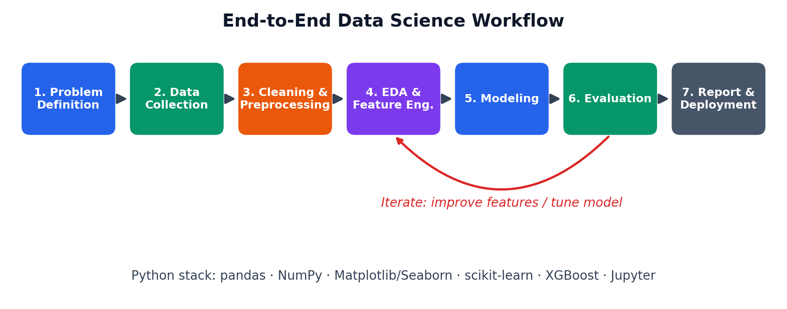
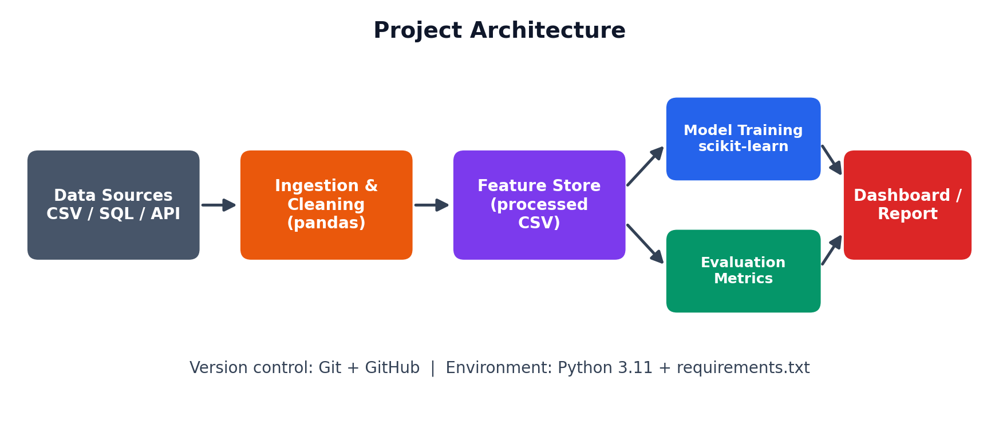
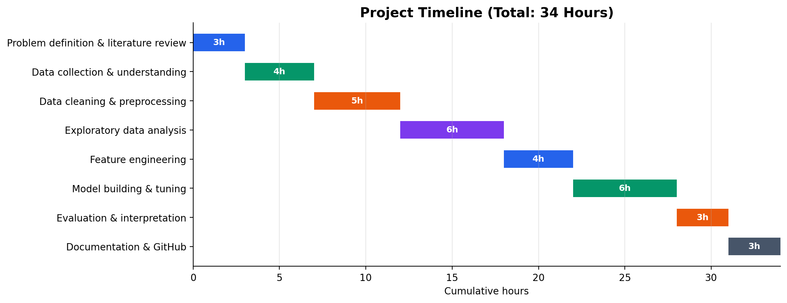

# Customer Churn Prediction – Project Plan & Starter Code

Week 1 internship task: planning and strategy design for a hypothetical data science project in Python.

## Problem
A telecom company ("TeleConnect") loses ~26% of customers each cycle. This project plans how to **predict which customers will churn** and **why**, so the retention team can act early.

## Objectives
- Identify key drivers of churn
- Build a classifier (target: recall ≥ 80% on churners, ROC-AUC ≥ 0.85)
- Explain results with feature importance / SHAP
- Recommend 3 retention strategies

## Methodology
Problem definition → Data collection → Cleaning → EDA & feature engineering → Modeling → Evaluation → Reporting





## Tech Stack
Python 3.11, pandas, NumPy, Matplotlib, Seaborn, scikit-learn, imbalanced-learn, XGBoost, SHAP, Jupyter

## Folder Structure
```
churn-prediction-project/
├── data/                 # raw & processed data (not tracked)
├── docs/                 # project plan (.docx) and diagrams
├── notebooks/            # EDA notebooks
├── reports/              # generated plots and results
├── src/
│   ├── data_cleaning.py
│   ├── feature_engineering.py
│   └── train_model.py
├── make_diagrams.py      # regenerates the diagrams
├── requirements.txt
└── README.md
```

## How to Run
```bash
python -m venv venv
source venv/bin/activate        # Windows: venv\Scripts\activate
pip install -r requirements.txt
python src/train_model.py       # runs a demo on synthetic data
```

## Timeline (34 hours)
Problem definition 3h · Data collection 4h · Cleaning 5h · EDA 6h · Feature engineering 4h · Modeling 6h · Evaluation 3h · Documentation 3h

## Status
Planning phase complete. Implementation skeleton included; full execution planned for later weeks.

## Author
[Your Name]
